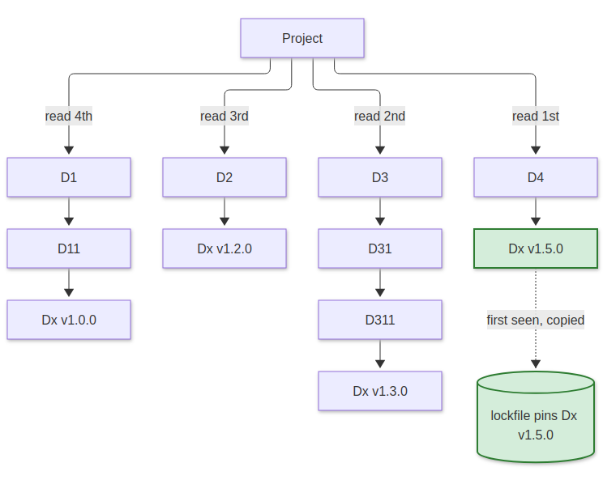

# A Look at Lean's Package Manager (Lake) and Registry (Reservoir)

[Lean 4](https://lean-lang.org/) is a programming language and theorem prover.
Four pieces are involved in getting and building its packages.

- The [Lean toolchain](https://github.com/leanprover/lean4/releases) is one release of Lean. It bundles the `lean` compiler, Lake and the core libraries, and is named by a GitHub repository and release tag, such as `leanprover/lean4:v4.36.0`.
- [Lake](https://github.com/leanprover/lean4/tree/master/src/lake) is the build tool and package manager that ships with every toolchain.
- [Reservoir](https://reservoir.lean-lang.org/) is the package registry.
- [elan](https://github.com/leanprover/elan) is the toolchain manager. It installs the compiler version named in a project's `lean-toolchain` file.

This post goes through the quirks we found in Lake and Reservoir and what they mean for supply chain security.
As Lean is increasingly used to verify software, the supply chain that delivers those proofs deserves the same scrutiny as any other.

## TL;DR

**Pros**

- The lockfile pins every direct and transitive dependency to a commit SHA ([§4](#4-mutable-references-and-locked-commits)).
- Compilation only respects the lockfile and its pinned commit SHAs ([§6](#6-the-lockfile-is-compulsory)).
- Reservoir builds every package with its own toolchain and the latest Lean releases. It shows whether each one compiles ([§9](#9-the-registry-indexes-source-but-hosts-binaries)).

**Cons**

- Manifests written in Lean are imperative and can run arbitrary code on your machine ([§1](#1-the-manifest-is-lakefiletoml-and-the-lockfile-is-lake-manifestjson)).
- Packages are distributed as source yet prebuilt binaries arrive by default for some of them. Lake or the package developer decides this and not the user. Lake does not verify the binaries it downloads ([§2](#2-source-by-default-and-binaries-decided-upstream)).
- A package can be referred to by a Git commit or a Git reference or the `version` in its manifest. These can conflict ([§3](#3-conflicting-versions)).
- Resolving the same manifest on a different day can pin different commits. Version ranges take the newest match on Reservoir. Branches and tags take whatever commit they point to in Git ([§3](#3-conflicting-versions) and [§4](#4-mutable-references-and-locked-commits)).
- The commit SHA is the only integrity check. There is no checksum of the package contents ([§5](#5-the-commit-sha-is-the-only-integrity-check)).
- The lockfile is flat. It does not show how deep a dependency sits or who pulled it in ([§7](#7-the-lockfile-is-flat)).
- Post-install hooks run arbitrary code on every dependency update. This includes the hooks of every dependency ([§8](#8-post-install-hooks-exist)).
- Two dependencies can depend on different versions of the same package. Lake has no way to resolve a version that works for both. A conflict only shows up as a compile error when it breaks an API ([§10](#10-no-dependency-conflict-resolution)).

## 1. The manifest is `lakefile.toml` and the lockfile is `lake-manifest.json`

The manifest comes in two forms.
The TOML form is declarative.

```toml
name = "hello"

[[require]]
name = "mathlib"
scope = "leanprover-community"
rev = "v4.36.0"
```

The Lean form is imperative, because it is a Lean program.

```lean
import Lake
open Lake DSL

package hello

require "leanprover-community" / "mathlib" @ git "v4.36.0"
```

Running `lake update` resolves either form into the lockfile.

## 2. Source by default and binaries decided upstream

Every dependency source is cloned into `.lake/packages` inside the project and compiled from source.
However, building from source can take hours, so Lake also downloads prebuilt binaries in three cases.

- **Reservoir builds.** Since Lean v4.13.0, Lake downloads a prebuilt archive from Reservoir for every package in the `leanprover` and `leanprover-community` scopes, such as batteries. Reservoir lists a hash for each archive, but Lake does not check it before unpacking.
- **mathlib's cache.** `lake exe cache get` is mathlib's own tool. It downloads prebuilt `.olean` files for the locked mathlib commit. Mathlib runs it through its own `post_update` hook, so every project that depends on mathlib downloads these files on `lake update` by default.
- **GitHub releases.** `preferReleaseBuild := true` makes Lake download a package's build archive from its GitHub release, uploaded with `lake upload`. The package's developer sets this in their own manifest.

In every case the choice is made upstream, by Lake or by the package's developer, not by the downstream user.
The user can only opt out, with `lake build --no-cache` or `MATHLIB_NO_CACHE_ON_UPDATE=1`.

## 3. Conflicting versions

There are two ways to declare a package's version.

### The `version` field in the manifest

```toml
# foo's manifest (lakefile.toml)
name = "foo"
version = "1.2.0"

# consumer's manifest (lakefile.toml)
[[require]]
name = "foo"
scope = "alice"
version = "1.2.0"
```

The `version` in a `require` can also be a range such as `>=1.0.0`.
`lake update` then fetches the package's versions from Reservoir and takes the first one that matches.

### A Git revision

```toml
# foo's GitHub repository
# release tagged v1.2.0

# consumer's manifest (lakefile.toml)
[[require]]
name = "foo"
scope = "alice"
rev = "v1.2.0"  # a tag, branch or commit
```

Nothing keeps the two in sync.
All 123 mathlib revisions indexed by Reservoir report version `0.0.0`, while their Git tags follow Lean releases (`v4.36.0`, `v4.37.0-rc1`).
This is probably done intentionally to ensure there is only one source of truth for the version.

## 4. Mutable references and locked commits

Requirements may point at branches and tags, both of which can be moved or force-pushed.

```toml
[[require]]
name = "mathlib"
scope = "leanprover-community"
rev = "v4.36.0"
```

The lockfile stores that request (`inputRev`) next to the commit it resolved to (`rev`).
This keeps the version pinned even if the tag is moved.

```json
{"name": "mathlib",
 "scope": "leanprover-community",
 "url": "https://github.com/leanprover-community/mathlib4",
 "inputRev": "v4.36.0",
 "rev": "fc4f59e577feb1a4956671bc04ac18aaaf8cd842",
 "inherited": false}
```

## 5. The commit SHA is the only integrity check

Lake stores no checksum of the fetched sources, and there is nothing like Go's checksum database.
This matters because references are mutable in the manifest.
A tag can be moved to a different commit (`v4.36.0` can be moved to a different commit).
If this commit is malicious, `lake update` will happily fetch it and record the new commit in the lockfile.
Thus, compromising the Lean project.

## 6. The lockfile is compulsory

Lake has two commands that matter here.

- `lake update` resolves dependencies. It turns every Git reference in the manifest into a commit SHA and writes those pins to the lockfile.
- `lake build` compiles the project and all its dependencies. It uses the pinned commits and never resolves anything itself.

Here is what `lake build` does in each case.

1. **No lockfile yet.** The first build runs an update and creates the lockfile.
2. **A new dependency.** The build stops and asks you to run `lake update`.
3. **A changed `rev`.** The build warns that the lockfile is out of date and keeps using the pinned commit.

## 7. The lockfile is flat

The lockfile lists every package in the workspace in one array.
Direct (the declared) dependencies are listed with `"inherited": false` while
transitive dependencies carry `"inherited": true`,

```json
{"name": "batteries",
 "inputRev": "main",
 "rev": "b4b25a3886a16daacaf6615c2eea7170a6e8f458",
 "inherited": true}
```

You cannot tell whether `batteries` sits at depth 2 or depth 5, or which dependency brought it in, and Lake has no `cargo tree` or `npm ls`.

## 8. Post-install hooks exist

A manifest written in Lean is a program, so loading a dependency's manifest already runs its code.
Packages can also register `post_update` hooks.

```lean
post_update pkg do
  let child ← IO.Process.spawn {cmd := "sh", args := #["-c", "echo hello from a dependency"]}
  let _ ← child.wait
```

`lake update` runs the hooks of every package in the workspace without a sandbox.

## 9. The registry indexes source but hosts binaries

Reservoir has no publish step and only indexes sources, but it runs a build farm and hosts the resulting binaries.

It crawls GitHub daily and lists every repository that meets its [inclusion criteria](https://reservoir.lean-lang.org/inclusion-criteria), which are a public non-fork repository, a lockfile at the repository root, an OSI-approved license and at least two stars.

It builds each package with the toolchain named in its own `lean-toolchain` file, and also with the latest stable and release-candidate Lean releases.
The package page then shows "builds on Lean v4.36.0" or "fails to build".

## 10. No dependency conflict resolution

Lake does no dependency conflict resolution.
It keeps one copy per package name and does not compare versions.
`lake update` works in three steps, described in a doc comment in [`Lake/Load/Resolve.lean`](https://github.com/leanprover/lean4/blob/611c117bfaf7b7ae1cfcf246ce6fba31e8f509e9/src/lake/Lake/Load/Resolve.lean#L446-L470).

1. Each `require` of the root is resolved to a commit and stored first, so the root's own pins always win.
2. The lockfile of each direct dependency is read, from the **last declared to the first**. Each entry is copied into the root's lockfile as `inherited`, unless a package with that name is already there.
3. Anything still missing is loaded breadth-first, siblings again in reverse order.

The source gives two reasons for the reverse order.
Later `require`s should shadow earlier ones, like later definitions in a file, and requirements written by the user should beat those inherited from dependencies.

Take the graph from our [earlier post](dependency-resolution/index.md).
The root requires `D1`, `D2`, `D3` and `D4` in that order, and each pulls in a different version of `Dx`.



Lake reads `D4`'s lockfile first, finds `Dx v1.5.0` there and copies it into the root lockfile.
The copies under `D3`, `D2` and `D1` are ignored.
Depth plays no role here, because each direct dependency's lockfile already lists its whole subtree, and Lake copies those lockfiles before the breadth-first walk starts.

| Ecosystem | Rule                                                              | `Dx`     |
|-----------|-------------------------------------------------------------------|----------|
| Maven     | Nearest to the root, then first declared                          | `v1.2.0` |
| Go        | Highest of the required minimums (MVS)                            | `v1.5.0` |
| Lake      | Root's own pin, then the lockfile of the last declared dependency | `v1.5.0` |

Because no versions are compared, conflicts are never reported during resolution.
If `D2` was tested against `Dx v1.2.0` and uses an API that `v1.5.0` removed, `lake update` succeeds and the error appears later as a compile error inside `D2`.
Adding a direct `require` for `Dx` in the root avoids this, since the root's pins always win.

## Related work

- Andrew Nesbitt, [GitHub Actions Has a Package Manager, and It Might Be the Worst](https://nesbitt.io/2025/12/06/github-actions-package-manager.html), 2025.
