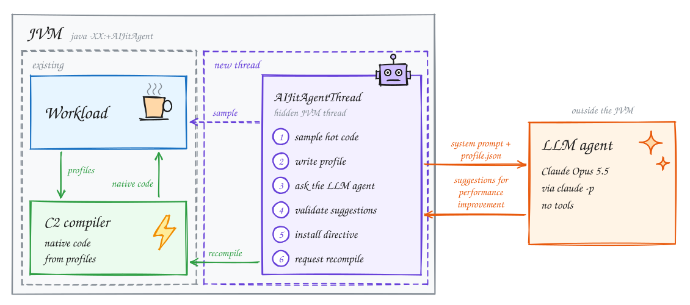
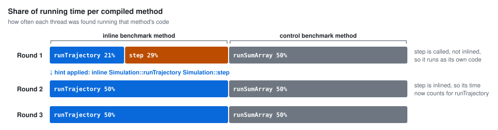
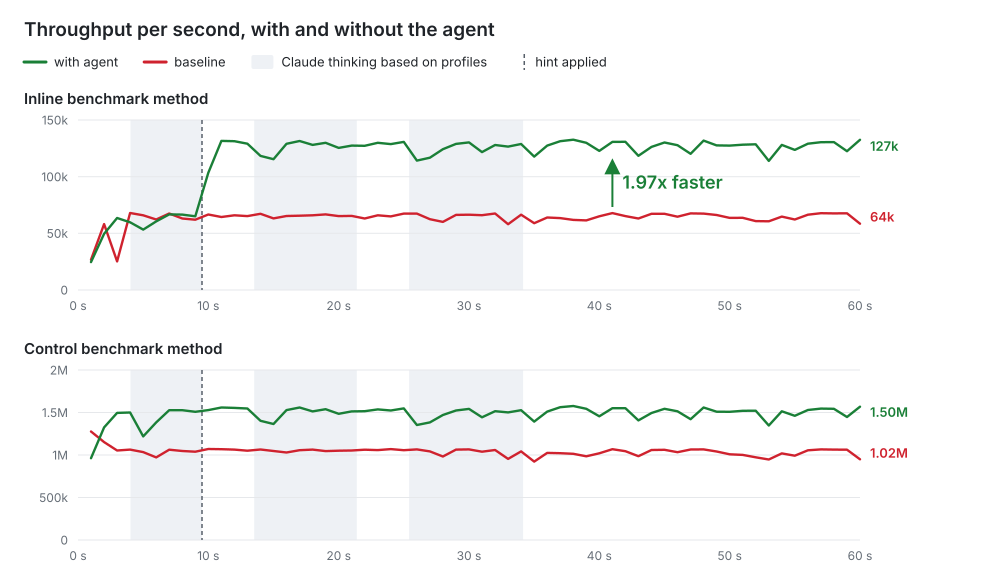

# JIT Tuning at Runtime using LLM Agent

HotSpot's optimizing JIT compiler, C2, decides performance improvements using fixed thresholds.
These thresholds suit Java programs in general.
Changing them affects every program that runs on the JVM.
But a specific program sometimes needs a specific exception.
We propose a proof of concept in which an LLM agent watches a running JVM, reads a profile of its hottest compiled code, and suggests C2 performance improvements.
On our workload, a single suggestion from Claude **nearly doubles the throughput of the benchmark code (1.97x)**, with no change to the program's results.

## Problem

C2 inlines a hot call only if the callee has at most `FreqInlineSize` = 325 bytes of bytecode.
The check counts every bytecode, including branches that almost never run.
Here is the hot callee in our workload, `step`, which moves a 3D point a small step along a path:

```java
static Vec step(Vec p, double t) {             // 481 bytes of bytecode in total
    double x = p.x() + 0.5 * t, y = p.y() - 0.25 * t, z = p.z() * 0.999;
    if (x * x + y * y + z * z < 1e6) {
        return new Vec(x, y, z);               // hot path: 68 bytes
    }
    // slow path: 413 bytes of arithmetic, never taken in this workload
    ...
}

static double trajectory(Vec base, int n) {
    double acc = 0;
    for (int i = 0; i < n; i++) {
        Vec v = step(base, i * 1e-4);          // 481 > 325: C2 does not inline step
        acc += v.x() + v.y() * 0.5 + v.z() * 0.25;
    }
    return acc;
}
```

The step method is hot, but it is too large for C2 to inline into trajectory as its size exceeds the `FreqInlineSize` threshold of 325 bytes (=481 bytes).
However, 413 of those bytes are in the slow path, which never runs in this workload.
So C2 does not inline `step` into `trajectory`.
As a result, every iteration pays for a call and allocates a `Vec` on the heap.

**Raising `FreqInlineSize` for the whole JVM also inlines every other large callee, which costs compile time and code cache.**
HotSpot already supports per-method exceptions through [compiler directives](https://openjdk.org/jeps/165).
But someone has to know, at runtime, which method needs which exception.

## Solution

We propose an LLM agent that watches a running JVM, reads a profile of its hottest compiled code, and suggests compiler directives to improve performance.

C2 then recompiles the affected methods with these directives.
Since C2 still generates all the code, correctness is guaranteed.

## Architecture



`-XX:+AIJitAgent` starts one extra thread inside the JVM, `AIJitAgentThread`.
Like C2's compiler threads, it is a hidden `JavaThread`.
It is never on the compile path, so C2 never waits for the LLM.

While overseeing the main workload, the agent thread does the following in a loop:

1. **Sleeps 3 s, then samples for 1 s.** Every 5 to 15 ms it briefly suspends each application thread and samples what methods are being executed.
2. **Writes a profile** of the hottest C2-compiled methods to `/tmp/aijit-<pid>-<round>-profile.json`.
3. **Runs the agent command.** Our `aijit_agent.py` sends the profile to Claude Opus 5.5 through `claude -p`, with a fixed [system prompt](#system-prompt).
The main thread keeps running while the agent thinks.
The agent asynchronously returns a list of performance improvement hints, one per line.
4. **Validates every hint.** The JVM checks each line of the answer on its own. It rejects and logs any hint that fails a check.
   1. The syntax must be correct: a verb and two arguments. The JVM skips the `#` reason lines.
   2. The method suggested for improvement must be in this round's profile, as the JVM has a method pointer for it.
5. **Installs** the accepted hints as a compiler directive and **deoptimizes** the method's current C2 code, including its OSR code.
6. **Requests a tier-4 recompilation**, which C2 performs with the directive.

## Agent Inputs: 1) the system prompt and 2) the profile

### System prompt

Every round uses the same system prompt. It also defines the two kinds of hint the agent may answer with:

```text
You tune the HotSpot C2 JIT compiler for a running Java program.

You get a JSON profile of the hottest C2-compiled methods, sampled while the
program runs. For each method: its share of samples, bytecode size, whether it
has loops, and every call site in the method and in the code C2 already
inlined into it, with profiled call counts, callee bytecode sizes, whether the
callee has loops, and whether C2 inlined the callee. Calls that C2 replaces
with hand-written code (intrinsics) are not listed. C2's default thresholds
are in c2_defaults.

You may emit two kinds of hints, one per line:
  inline <method> <callee>   force C2 to inline <callee> when compiling <method>
  unroll <method> <limit>    LoopUnrollLimit (max loop body size in IR nodes,
                             8..600) when compiling <method>
<method> must be a "name" from "methods" and <callee> a "callee" listed in that
method's "calls", copied exactly.

A hint never changes program results, but each one costs a recompilation and a
bad one can slow the program down. Only hint where the profile gives a concrete
reason, for example:
- a hot call site that C2 did not inline because the callee is above
  FreqInlineSize; inlining removes call overhead and lets escape analysis
  remove allocations of objects the callee returns;
- a hot loop whose body is likely above LoopUnrollLimit and is not
  vectorizable (e.g. table lookups or loop-carried state).
Do not repeat anything in "applied_hints". Emitting no hints is fine.

Before each hint write one line starting with '#' giving the reason.
Output nothing else: no prose, no markdown.
```

### Profile

Here is an excerpt of [round 1's profile](rounds/round-1-profile.json) from results.

```js
{
  "round": 1,                                // 1 to 3
  "total_samples": 199,                      // times the sampler finds a thread in optimized code
  "c2_defaults": {...},                      // C2's global thresholds, e.g. FreqInlineSize 325
  "applied_hints": [],                       // hints accepted in earlier rounds
  "methods": [                               // hottest C2-compiled methods
    {"name": "Simulation::runTrajectory",    // Class::method, as hints and directives name it
     "signature": "()V",                     // JVM type descriptor
     "samples": 42,                          // the sampler finds the method running 42 of 199 times
     "bytecode_size": 26,                    // size of its bytecode
     "has_loops": true,                      // the bytecode has a backward branch
     "osr": true,                            // OSR code: a running loop jumps into it
     "c2_code_bytes": 488,                   // machine code, inlined callees included
     "invocations": 1, "backedges": 110599,  // calls and loop iterations during warm-up
     "calls": [                              // calls in the method and in its inlined callees
       {"caller": "Simulation::runTrajectory", "callee": "Simulation::trajectory", ..., "inlined": true},
       {"caller": "Simulation::trajectory",  // contains the call: the method or an inlined callee
        "callee": "Simulation::step",        // declared target of the call
        "count": 193976,                     // calls counted during warm-up
        "callee_bytecode_size": 481,         // what C2 compares with FreqInlineSize
        "callee_has_loops": false,           // the callee has a backward branch
        "callee_c2_code_bytes": 368,         // size of the callee's own C2 code
        "inlined": false},                   // C2 does not inline the callee here
       ...]},
    ...]
}
```

> **[INFO]** The counts `count`, `invocations` and `backedges` come from the interpreter and the profiling C1 tier. They stop growing once a method runs as C2 code, so they describe warm-up, not the current rate.

## Experimental Methodology

We run the benchmark twice on the same JDK build, 60 s each: once without the agent (the baseline) and once with `-XX:+AIJitAgent`.
Both runs report the throughput of each benchmark method every second, in operations per second (ops/s).
We compare the steady-state throughput of the two runs, which is the mean of the last 30 s.
The benchmark, `Simulation`, runs two benchmark methods, each on its own thread:

- **inline** (`runTrajectory`): calls `trajectory`, which moves a 3D point 2,000 small steps along a path by calling `step`. This is where C2's inlining limit bites.
- **control** (`runSumArray`): sums a 4,096-element `int` array. C2 already compiles this loop well, so the agent should leave it alone.

Each benchmark method also checks every result against the one the interpreter computes at startup.
Wrong compiled code shows up as a mismatch.

In the agent run, the agent thread goes through three rounds.
Each round is one `claude -p` call, which is a new Claude Code session.
The agent runs Claude from `/tmp`, so Claude Code saves the sessions under `~/.claude/projects/-tmp/`, one per round.
In each session, the system prompt and the profile go in, and the hints come back as the answer.
We publish each transcript and redact only the account email.

### Experimental setup

- **JDK:** OpenJDK 28-internal, mainline `master` at `3104115c2a0` plus our AIJitAgent patch, [commit `e8c1a26`](https://github.com/algomaster99/jdk/commit/e8c1a26cda5fd92abdcc6e33bea8ecd7a3f03ea4). Its README explains how to build and run it.
- **Machine:** a laptop with a 12th-gen Intel Core i7-1280P (performance and efficiency cores), Linux 6.8.

## Results

**TLDR: The agent suggests one hint, which the JVM accepts. The JVM recompiles the affected method with the hint, and throughput jumps from 64k to 127k ops/s (1.97x throughput).**

Running the benchmark produces three rounds of agent suggestions, which the JVM accepts and applies.

All the outputs can be found in the [rounds](rounds/) directory.


The table links each round's session transcript, and the prompt and answer on their own.

| Round | Session | Prompt | Answer | Agent time | Cost | Hints |
|---|---|---|---|---|---|---|
| 1 | [`a4ed3ee7`](rounds/round-1-session.jsonl) | [profile](rounds/round-1-profile.json) | [answer](rounds/round-1-answer.txt) | 5.5 s | $0.032 | `inline Simulation::runTrajectory Simulation::step` |
| 2 | [`53a4b16e`](rounds/round-2-session.jsonl) | [profile](rounds/round-2-profile.json) | [answer](rounds/round-2-answer.txt) | 7.9 s | $0.036 | none |
| 3 | [`39e4d74d`](rounds/round-3-session.jsonl) | [profile](rounds/round-3-profile.json) | [answer](rounds/round-3-answer.txt) | 8.7 s | $0.064 | none |

*Agent time* is how long the JVM waits for the agent command, as the JVM logs it.

### Round 1: one hint

In round 1, `step` is the second-hottest method, with 29% of the running time.
Under `runTrajectory`, its `calls` row reads `trajectory → step`: 193,976 calls, 481 bytes, `"inlined": false`.
Claude's answer:

```
# Simulation::step (481 bytes, above FreqInlineSize 325) is not inlined into trajectory despite 193976 calls; inlining it lets escape analysis remove the Simulation$Vec it allocates and returns
inline Simulation::runTrajectory Simulation::step
```

The JVM accepts compiler directives as JSON.
So the agent thread turns the hint into the following directive and installs it:

```json
[{"match": "Simulation::runTrajectory", "c2": {"inline": ["+Simulation::step"]}}]
```

### Round 2: the hint takes effect, nothing more to do

Round 2's profile shows the effect.
`step` is no longer a hot method of its own, and `trajectory → step` is now `"inlined": true`.
`runTrajectory`'s C2 code grows from 488 to 1,024 bytes, and the inline thread spends all of its running time in it.

Claude's answer is a single comment and no hint:

```
# No hints: every hot call site is already inlined, and the remaining loops are either vectorizable (sumArray) or too large for unrolling to help (trajectory with step inlined).
```

### Round 3: same answer

Round 3's profile is almost identical to round 2's, and Claude again declines: *"All hot call sites are already inlined, and no hot loop has a concrete reason for an unroll hint, so no hints this round."*
Its first reply contains only hidden reasoning and no visible text.
So the `claude` CLI automatically asks it to continue.
The second reply is the answer above, which is why this round costs about twice as much.

### Where the time goes



### Throughput



| Benchmark method | Baseline (ops/s) | With the agent (ops/s) | Change |
|---|---|---|---|
| inline (`runTrajectory`) | 64,424 | 126,833 | **1.97x** |
| control (`runSumArray`) | 1,021,285 | 1,502,810 | +47% |

The per-second numbers of both runs are in the [full output](rounds/run-output.txt) (absolute paths shortened).

- **The hint pays off immediately.** The JVM accepts it 9.5 s after start. The second before runs at 65,015 ops/s. The second that contains the recompilation averages 103,387 ops/s, and the next one 131,515 ops/s. Throughput stays there for the rest of the run.
- **The program never waits for Claude.** The three rounds (shaded) take 5 to 9 s each and cost $0.13 in total. Both benchmark methods keep running throughout.
- **No result changes.** Both runs have 0 mismatches against the interpreter's results.

> **[INFO]** The control benchmark method's +47% is noise. The agent never touches it, and the gap already exists in the first 9 s, before any hint.

## Related work

[A-JIT: Agentic Just-In-Time Software Construction](https://arxiv.org/abs/2609.10248) (Marron and Barr, 2026)

## Takeaways

- The AI agent suggests one performance improvement at runtime. It raises throughput **1.97x**.
- The agent runs asynchronously in its own thread so the application never waits for it.
- The architecture builds on HotSpot's profiling and JIT compilation. The agent only makes decisions, and C2 still generates all the code.
